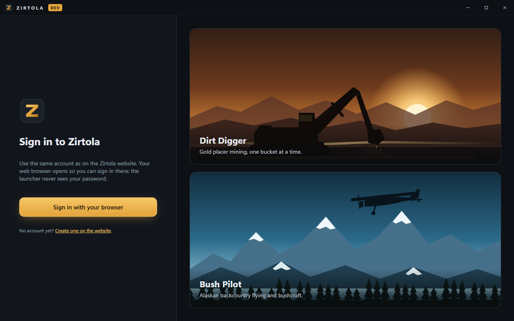
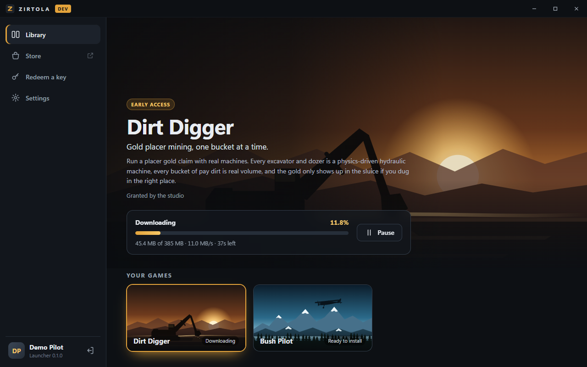
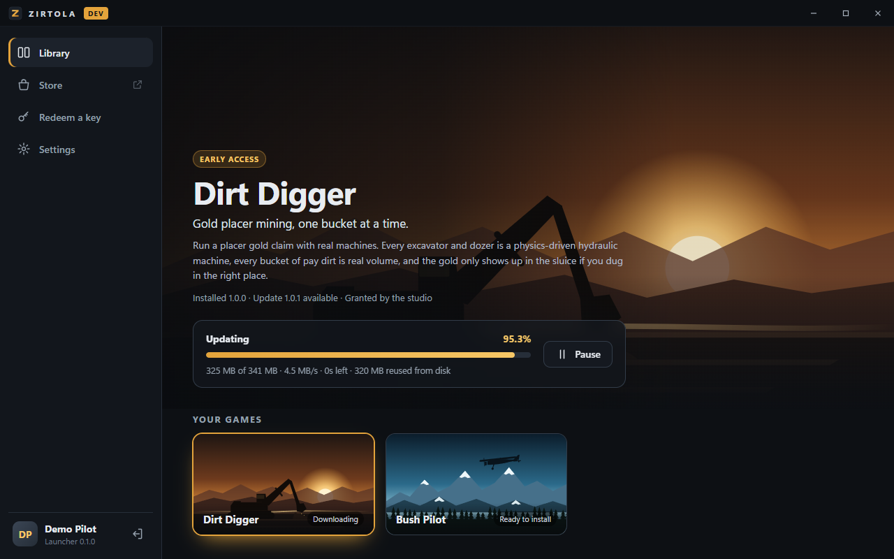
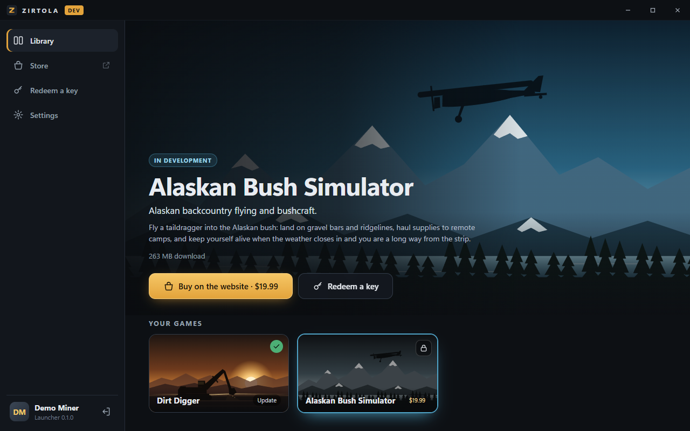
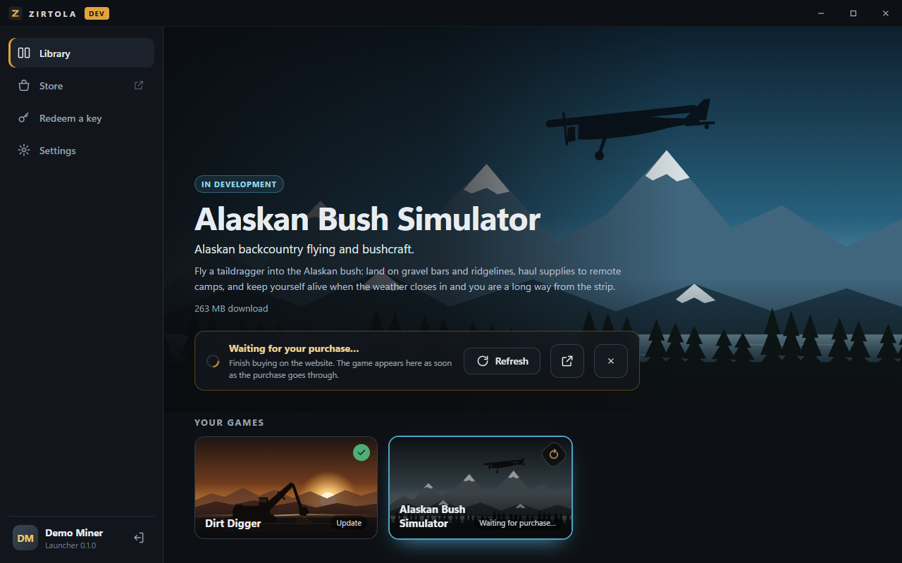
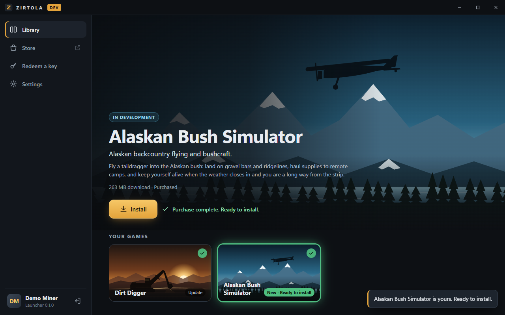
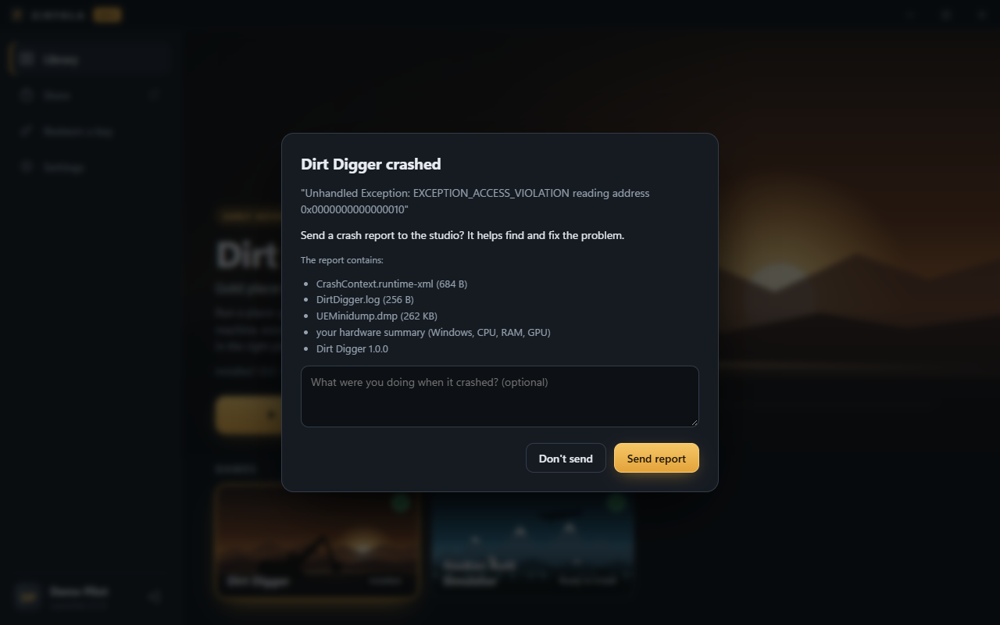
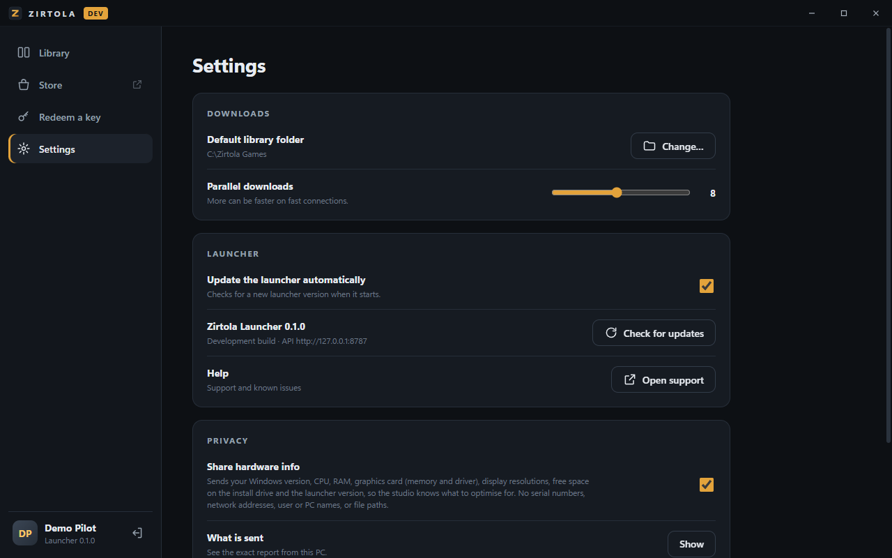

# Zirtola Launcher

The Windows desktop launcher for Zirtola games. Players install it from the
studio's website, sign in with their Zirtola account (the same account as on
the website), and download, update, verify and play the games they own.

> The repository is named `zitrola-launcher`; the product is **Zirtola**.

| Sign in | Downloading | Patching (only changed chunks) |
| --- | --- | --- |
|  |  |  |

| Locked game | Waiting for the purchase | Bought: ready to install |
| --- | --- | --- |
|  |  |  |

| Crash report prompt | Privacy settings |
| --- | --- |
|  |  |

## Features

- **Sign in with the website account**: OAuth 2.0 authorization code + PKCE in
  the system browser with a loopback redirect. The launcher never sees the
  password; the refresh token lives in Windows Credential Manager.
- **Library**: the studio's games from the website. Owned games (purchase,
  redeemed key, studio grant) can be installed; others link to the store.
  Redeem keys in the launcher or on the website.
- **Big-game downloads**: content-addressed chunks (FastCDC, ~4 MiB average)
  fetched in parallel (8 by default), each SHA-256 checked before it is
  written. Pause/resume (also across restarts), install-folder choice,
  disk-space check, verify and repair, uninstall.
- **Patching**: a new version only downloads chunks the installed build does
  not already have; unchanged chunks are copied locally. The old build stays
  playable until the new one is complete, then files are swapped in.
- **Signed everything**: build manifests are Ed25519-signed and checked against
  public keys pinned in the launcher; launch tokens are EdDSA JWTs the game can
  verify; updates are minisign-signed; the installer is Authenticode-signed
  once a certificate is configured.
- **Launch with a license token**: a 5-minute token in the game's environment
  (`ZIRTOLA_SESSION_TOKEN`) so the game can check its license; each launch
  records the device so the studio can see and reset activations.
- **Buying**: locked games show a lock badge and "Buy on the website" (with the
  price when the site provides one). After the player clicks it, the launcher
  waits for the purchase (re-checking every 7 s for up to 15 minutes, right away
  when the window regains focus, and on the site's `zirtola://refresh` link) and
  highlights the game with Install as soon as it is owned.
- **Hardware info** (opt-out, Settings → Privacy, with a "Show what is sent"
  view): OS version/build, CPU, RAM, GPUs with VRAM and driver, displays, free
  space on the install drive, launcher version. Nothing identifying.
- **Crash reports**: when a game crashes (non-zero exit or a new Unreal crash
  folder) the player is asked whether to send the log, crash context and
  minidump with an optional comment. Games can also report directly
  (CrashReportClient or a small upload), see docs/GAME_INTEGRATION.md.
- **Self-update** from GitHub Releases (`latest.json`), offered in the sidebar.
- **Controller-friendly**: D-pad/stick move focus, A select, B back, LB/RB
  switch game, Start play/install, Y redeem key, View settings; button hints
  appear when a gamepad is used. Arrow keys work too.
- **All art is in the repo and made for it**: the logo and game key art are
  hand-written SVG, installer bitmaps are generated by `scripts/gen-art.mjs`,
  icons by `tauri icon` from the SVG. No downloaded assets or fonts.

## Stack, and why

**Tauri 2 (Rust) + TypeScript UI (Vite, no framework).**

| | Tauri + Rust | Electron + TypeScript |
| --- | --- | --- |
| Installer | **3.3 MB** NSIS (uses the WebView2 already in Windows 10/11) | 80–100 MB (ships Chromium + Node) |
| Memory at idle | ~40–80 MB | 150–300 MB |
| Big resumable downloads | Native Rust: tokio, positional writes, SHA-256 with CPU extensions, no GC pauses | Node streams; workable but slower hashing and more memory |
| Auto-update | Official updater plugin, minisign-signed feed, GitHub Releases | electron-updater, similar |
| Security | No Node in the renderer; the UI can only call the commands we register; strict CSP | Must lock down Node integration / preload carefully |
| Code signing | `signCommand` hook signs every binary (Azure Artifact Signing, OV, EV) | Similar via electron-builder |

The download/patch engine is the heart of a game launcher and Rust is the best
tool for it; Tauri keeps the download size small for a first impression. The
UI is plain TypeScript and CSS: a handful of screens do not need a framework.

## Repository layout

```
crates/zirtola-core/    API client, signed manifests, launch tokens, install/patch/verify engine (+ tests)
src-tauri/              Tauri shell: OAuth sign-in, commands, background jobs, updater, NSIS config
ui/                     Launcher UI (TypeScript, CSS, SVG art, gamepad navigation)
tools/zirtola-publish/  CLI: chunk + hash + sign a packaged game build; key generation
examples/license-check/ Reference license check for games (also the stand-in game in mock builds)
mock-server/            Mock website implementing the API (zero dependencies)
scripts/                sign.ps1 (Authenticode hook), e2e tests, secret scan, art generator
docs/                   API contract, signing, releasing, game integration
```

## Architecture

```
            ┌──────────────── Zirtola website (Next.js, Railway) ───────────────┐
            │ /oauth/authorize  consent page using the site session             │
 browser ──▶│ /oauth/token      code+PKCE → access (15 min) + rotating refresh  │
            │ /api/launcher/v1  config, keys, catalog, me, entitlements,        │
            │                   keys/redeem, games/{id}/latest|manifest,        │
            │                   launch-tokens (+ device activations)            │
            └───────────────▲─────────────────────────────────▲─────────────────┘
                            │ HTTPS (JSON)                    │ signed manifest +
                            │                                 │ chunk URL template
 ┌──────────────────────────┴──────────┐                      │
 │ Zirtola Launcher (Tauri)            │     ┌────────────────┴────────┐
 │  UI (WebView2) ── invoke ──▶ Rust   │────▶│ CDN: /{game}/chunks/ab/ │
 │  auth.rs  jobs.rs  commands.rs      │     │ ab12… (immutable)       │
 │  zirtola-core: apply / verify /     │     └─────────────────────────┘
 │  uninstall / launch                 │
 └──────────────┬──────────────────────┘
                │ spawn with ZIRTOLA_SESSION_TOKEN
                ▼
            Game (UE5) ── verifies EdDSA token (offline or /v1/launch-tokens/verify)
```

Install folder layout: game files plus `.zirtola/manifest.json` (signed manifest
of the installed build) and, while a job is unfinished, `.zirtola/pending.json`
(journal of verified chunks). Changed files are rebuilt as `<file>.zpart` next
to the original and renamed into place only when every chunk is verified. The
launcher's own state lives in `%APPDATA%\com.zirtola.launcher\` (installs list,
settings, random device id).

## Running it

Requirements: Windows 10/11, Node 20+, Rust (stable, MSVC), Visual Studio
Build Tools with the C++ workload, WebView2 (preinstalled on Windows 11).

```powershell
npm install
npm run mock:seed      # once: builds tools, creates ~620 MB of signed demo builds in mock-server/.data
npm run mock           # mock website on http://127.0.0.1:8787 (keep running)
npm run dev            # launcher in dev mode, talking to the mock
```

Sign in opens your browser at the mock's account picker (Demo Miner owns Dirt
Simulator, Demo Pilot owns both, New Player owns nothing; demo keys are shown on
the mock store pages). To see patching, make the 1.0.1 builds live while the
launcher is open: `node mock-server/release.mjs dirt-simulator 1.0.1`, then
return to the Library.

Useful switches for the mock: `MOCK_THROTTLE_KBPS=1500` (slow downloads, to try
pause/resume), `MOCK_FAIL_RATE=0.1` (random 503s, to see retries),
`MOCK_AUTO_APPROVE=acct_pilot` (skip the account picker).

To run the launcher against a local copy of the website instead:
`$env:ZIRTOLA_API_BASE="http://localhost:3000/api/launcher"; npm run dev`
(dev builds only; release builds use the URL they were built with).

Tests:

```powershell
cargo test --workspace     # manifest/token crypto, path safety, install/patch/pause/resume/repair/uninstall
npm run e2e                # API contract against the mock, incl. the reference game's license check
node scripts/site-contract.mjs   # same against a running website (SITE=..., interactive sign-in)
npm run check-secrets      # run before every push
```

Release build (unsigned locally): `npm run build` →
`target\release\bundle\nsis\Zirtola Launcher_<version>_x64-setup.exe`.

## API contract

See **[docs/API.md](docs/API.md)**: OAuth endpoints, entitlements, key
redemption, signed manifests and chunk URLs, launch tokens and activations,
build publishing. The website implementation lives in the `retail-store` repo
(`src/app/api/launcher`, `src/app/oauth`, `src/lib/launcher`).

## Code signing

See **[docs/SIGNING.md](docs/SIGNING.md)**. Recommendation: **Azure Artifact
Signing** (~$9.99/month) if the studio is eligible (US/Canada individuals, or
companies in the US, Canada, EU, UK); otherwise an OV certificate with cloud
signing (~$150–400/year). EV no longer skips SmartScreen (since March 2024).

## Distribution without a certificate yet

See **[docs/DISTRIBUTION.md](docs/DISTRIBUTION.md)**: which channels are
legitimate before we have a code-signing certificate (website + winget now,
signing as soon as possible), and why the Microsoft Store, a zip or a
bootstrapper do not work for this launcher.

## Releasing

See **[docs/RELEASING.md](docs/RELEASING.md)**: push a `vX.Y.Z` tag, GitHub
Actions builds, signs and drafts the release with the installer and
`latest.json`; publish the draft to ship the update. The same document covers
publishing game builds (`zirtola-publish` → CDN → website).

## Integrating a game

See **[docs/GAME_INTEGRATION.md](docs/GAME_INTEGRATION.md)** for the
environment variables the launcher passes and Unreal C++ for the license check.

## Security notes

- Never commit secrets: `.gitignore` excludes key files and `.env`; `scripts/check-secrets.mjs` runs in CI.
- Manifest paths are validated (no `..`, absolute paths, drive letters, ADS, reserved names) before anything is written.
- The UI is served from the app bundle with a strict CSP; only registered Rust commands are callable; external links open only `http(s)` URLs in the system browser.
- Dev-only behaviour (trusting keys served by a loopback API, runtime `ZIRTOLA_API_BASE`, `ZIRTOLA_NO_BROWSER`) is compiled out of release builds.
